<div align="center">



[← Back to Ronald Rex's engineering portfolio](https://github.com/RONALD-REX-7)

</div>

---

# SIH26025 — AI-Enabled Low-Cost Real-Time Mine Subsidence Monitoring & Early Warning System

> **Smart India Hackathon 2026 — Problem Statement ID: SIH26025**  
> **Nodal Ministry:** Ministry of Coal / Coal India Limited (CIL)  
> **Geotechnical Baseline:** Moonidih Underground Project (BCCL, Jharia Coalfield — Deep Longwall Profile)  
> **Interactive Demonstration Scenario:** Bhowra-West Colliery (Seam VII Leasehold, Jharia Coalfield — 16 Nodes / 80 Transducers)  
> **Regulatory Baseline:** Directorate General of Mines Safety (DGMS) CMR 2017 (Reg 112 & 114)  
> **Live Interactive Demonstrator:** [https://mineguard-sih26025.vercel.app](https://mineguard-sih26025.vercel.app)  

---

> [!IMPORTANT]
> **Owner-Confirmed Engineering Baseline & Evidence Disclosure**:
> - **Firmware Reality**: ESP32-S3 firmware source code exists, is implemented in C++, and compiles deterministically with PlatformIO.
> - **Hardware Integration Reality**: Physical hardware is **not fully integrated**. Breakout boards and bench tests have been partially exercised, but the system is **not a completed physical prototype** or a field-validated mine monitoring installation.
> - **Measurement & Telemetry Reality**: Bench measurements (TEST-01, TEST-02) represent owner-reported prototype readings. Telemetry feeds, deformation curves, and station metrics on the digital platform represent a **calibrated synthetic simulation** modeled after Barakar sandstone/shale geotechnical mechanics for SIH demonstration.
> - **Classification**: Adheres strictly to the **10-Tier Evidence Taxonomy Standard** documented in [`docs/STATUS.md`](./docs/STATUS.md) and [`docs/TESTING.md`](./docs/TESTING.md).

---

## 1. Project Mission & Overview

Underground coal mining in India (both bord-and-pillar depillaring and mechanised longwall extraction) faces severe strata hazards. Unexpected ground convergence, roof sagging, and surface subsidence threaten underground workforce safety and surface civil infrastructure (railways, pipelines, roadways, settlements).

Existing commercial subsurface monitoring stations imported from abroad cost **₹1,50,000 to ₹4,50,000 per station**, restricting colliery deployments to sparse, isolated locations.

**SIH26025** is a vertically integrated, open-architecture solution that delivers:
1. **Low-Cost Subsurface Sensing Hardware Design:** Multi-parametric nodes engineered with precision MEMS inclinometry, 24-bit delta-sigma strain bridge ADC, and sub-GHz LoRa (IN865) achieving an itemized fabrication cost estimate of **₹4,850 (~$58 USD)** — a **30x cost reduction** (Tier 1 Design/BOM estimate).
2. **On-Device Edge TinyML:** Real-time rate-of-change and robust Z-score analysis on an ESP32-S3 microcontroller, dynamically escalating reporting from 300s to 10s upon detecting anomalous ground sag.
3. **Multi-Station Spatial Correlation & Sensor Fusion:** Eliminates false alarms by requiring Pearson correlation agreement ($r > +0.75$) across adjacent stations and multi-modal agreement between tilt, displacement, strain, and acoustic emission.
4. **Statutory DGMS Compliance:** Purpose-built around the mandatory requirements of the **Coal Mines Regulations (CMR) 2017 Regulation 112** (Strata Control and Monitoring Plan - SCAMP), featuring digital shift sign-offs and immutable audit trails.

---

## 2. End-to-End System Architecture

```
┌─────────────────────────────────────────────────────────────────────────────────────────────┐
│ 1. SUBSURFACE SENSING & EDGE COMPUTING                                                      │
│    • BNO085 Dual-Axis Digital Inclinometer (0.01° Resolution) ──────────────► I2C Bus       │
│    • ADS1220 24-Bit Sigma-Delta ADC (Vibrating Wire Strain Bridge) ────────► SPI Bus       │
│    • Murata Piezoelectric Geophone (Microseismic Acoustic Emissions) ───────► ADC1          │
│    • ESP32-S3 Microcontroller (FreeRTOS, Circular Buffer N=30, TinyML EWMA & Z-Score)       │
│    • SX1262 LoRa Transceiver (+20 dBm, 865.2 MHz IN865 Band, 20-Byte CRC-16 Binary Packet) │
└──────────────────────────────────────────────┬──────────────────────────────────────────────┘
                                               │ LoRa RF Link (Tunnels / Borehole Cables)
                                               ▼
┌─────────────────────────────────────────────────────────────────────────────────────────────┐
│ 2. COMMUNICATION & INGESTION BACKHAUL                                                       │
│    • Pit-Bottom LoRaWAN Gateway / Surface Concentrator (Ethernet / 4G Cellular Backhaul)   │
│    • HTTPS Ingestion Endpoint: POST `/api/telemetry/ingest` (Protected by `x-api-key`)      │
│    • Zod Contract Validation, De-duplication, and Batch Ingestion                           │
└──────────────────────────────────────────────┬──────────────────────────────────────────────┘
                                               │ HTTPS / TLS 1.3
                                               ▼
┌─────────────────────────────────────────────────────────────────────────────────────────────┐
│ 3. PERSISTENCE & STATISTICAL INTELLIGENCE                                                   │
│    • Supabase Managed PostgreSQL with Row-Level Security (RLS) & Realtime WebSockets        │
│    • Hybrid Anomaly Pipeline: Running MAD, Robust Z-Score, EWMA, & Isolation Forest        │
│    • Pearson Inter-Station Spatial Correlation & Multi-Modal Sensor Fusion                  │
│    • 5-State Risk Engine: Normal (1) ➔ Advisory (2) ➔ Watch (3) ➔ Warning (4) ➔ Critical (5) │
└──────────────────────────────────────────────┬──────────────────────────────────────────────┘
                                               │ Realtime Sync
                                               ▼
┌─────────────────────────────────────────────────────────────────────────────────────────────┐
│ 4. STATUTORY OPERATIONS, GIS & ALERT CENTER                                                 │
│    • Real-Time Industrial Operations Dashboard (12 Operational Views)                       │
│    • Multi-Layer Vector GIS (Underground Panels, Goaf Lines, Faults, Surface Railway)       │
│    • Web Audio API Synthesizer Siren (Audible Emergency Alarm)                              │
│    • DGMS CMR 2017 Regulation 112 Statutory Shift Sign-Off Modal                           │
│    • Immutable Cryptographic Audit Log (`/audit`) & DGMS Form IV Compliance Reporting       │
└─────────────────────────────────────────────────────────────────────────────────────────────┘
```

---

## 3. Ten-Tier Technical Evidence Classification

In compliance with professional engineering standards, all technical claims associated with SIH26025 are categorized below:

| Technical Claim / Subsystem | Target Figure | Evidence Classification | Verification & Source Details |
| :--- | :---: | :---: | :--- |
| **BNO085 Inclinometer Jitter** | $\pm 0.014^\circ$ | **Tier 7** | Owner-reported bench measurement (`docs/TESTING.md` TEST-01). Driver probes 0x4A with MPU6050 fallback at 0x68. Raw telemetry log required for independent verification. |
| **ADS1220 ADC Linearity** | $R^2 = 0.9998$ | **Tier 7** | Owner-reported bench measurement with decade box (`docs/TESTING.md` TEST-02). Raw calibration curve required. |
| **ADS1220 Strain Noise Floor** | $0.22\ \mu\epsilon$ | **Tier 7** | Owner-reported bench measurement (`docs/TESTING.md` TEST-02). Raw noise histogram required. |
| **TinyML Strata Anomaly Recall** | 93.00% Recall / 83.60% Accuracy | **Tier 5** | Independently reproducible mathematical simulation on 1,000 synthetic geotechnical vectors (`ml/evaluate_model.py`, seed=123). |
| **Unit Fabrication Cost** | ₹4,850 ($58.40 USD) | **Tier 1** | Projected engineering prototype BOM estimate across 13 COTS components (`hardware/bom/BOM.md`). |
| **LoRa Sub-GHz Range** | 8 km Surface / 2.5 km Underground | **Tier 1 / Tier 7** | Theoretical link budget projection based on SX1262 specs (Tier 1); lab RF bench transmission is owner-reported (Tier 7). |
| **ESP32-S3 Firmware Build** | 0 Compilation Errors | **Tier 3** | Deterministic PlatformIO build: RAM 6.4%, Flash 9.9% (`firmware/src/`). |
| **Digital Platform & API Tests**| 42/42 Tests Passing | **Tier 4** | Vitest test suite executing in CI across 9 test suites (`src/`). |

*Full itemized methodology, instruments, and evidence audit trails are documented in [`docs/STATUS.md`](./docs/STATUS.md).*

---

## 4. Hardware BOM Summary (Low-Cost Focus)

| Subsystem | Key Components | Unit Cost (INR) | Unit Cost (USD) | Evidence Tier |
|---|---|---|---|:---:|
| Core Processing & LoRa | ESP32-S3-WROOM-1 + Semtech SX1262 (IN865) | ₹ 1,180 | $ 14.20 | Tier 1 (Design BOM) |
| Transducers & 24-Bit ADC | BNO085 Inclinometer + TI ADS1220 24-bit ADC + Piezo | ₹ 1,420 | $ 17.10 | Tier 1 (Design BOM) |
| Power Subsystem | 3.2V 3200mAh LiFePO4 + TI TPS7A2533 Ultra-Low Noise LDO | ₹ 680 | $ 8.20 | Tier 1 (Design BOM) |
| Enclosure & Mounting | IP68 Die-cast Enclosure + SS304 Rockbolt Clamp Bracket | ₹ 1,150 | $ 13.85 | Tier 1 (Design BOM) |
| PCB & Passives | 4-Layer FR4 1.6mm PCB + M12 IP68 Brass Cable Glands | ₹ 420 | $ 5.05 | Tier 1 (Design BOM) |
| **Total Unit Production Cost** | — | **₹ 4,850** | **$ 58.40** | **Tier 1 (Design BOM)** |

*Complete itemized specifications, part numbers, and suppliers are documented in [BOM.md](./hardware/bom/BOM.md).*

---

## 5. Quickstart & Verification Guide

### 5.1 Web Platform & Dashboard (Next.js 16)

```bash
# 1. Install dependencies
npm install

# 2. Environment configuration
cp .env.example .env.local

# 3. Run automated test suite (42 tests)
npm run test

# 4. Run ESLint verification (0 warnings, 0 errors)
npm run lint

# 5. Build production bundle (Turbopack)
npm run build

# 6. Start local server
npm start
```
Access the operations dashboard at `http://localhost:3000`.

### 5.2 Embedded Firmware (ESP32-S3)

```bash
cd firmware
pio run                          # Compile firmware (Tier 3 verified)
pio run --target upload          # Flash to ESP32-S3
pio device monitor               # Open serial debug monitor (115200 baud)
```

### 5.3 Machine Learning Pipeline (Python)

```bash
# Generate synthetic strata data, train baseline, and benchmark performance (Tier 5 verified)
python ml/data_generator.py
python ml/train_anomaly_detector.py
python ml/tinyml_export.py
python ml/evaluate_model.py
```

---

## 6. Engineering Truth & Safety-Critical Disclaimers

> [!CAUTION]
> **Safety-Critical Geotechnical Operational Notice:**
> 1. **Anomaly Detection vs Collapse Prediction:** The SIH26025 platform detects abnormal acceleration in roof sag, borehole displacement, and rockbolt strain relative to calibrated baselines. It **does NOT** claim deterministic prediction of the exact hour or second of catastrophic mine collapse.
> 2. **Decision Support Only:** The system serves as early-warning decision support. Final evacuation and support intensification decisions remain the statutory responsibility of the certified Mine Manager and Safety Officer under DGMS CMR 2017.
> 3. **Intrinsic Safety Certification Boundary:** The hardware circuitry is designed with low-voltage power rails and current-limiting zener barriers for intrinsic safety (Ex 'i') compliance under IS/IEC 60079-11. However, **formal statutory testing and certification by CIMFR Dhanbad / DGMS has NOT yet been undertaken**. Physical deployment in operational gassy coal faces requires formal statutory certification.
> 4. **Hardware Prototype Boundary:** Physical hardware is in partial prototype bench testing (Tier 8); full multi-sensor integration (Tier 9) and underground colliery validation (Tier 10) are planned.

---

## 7. Quality Assurance & Test Verification Results

* **ESLint Verification:** Exited `0` with **0 errors and 0 warnings**.
* **Vitest Automated Suite:** Exited `0` with **42 of 42 tests passing** across 9 test suites in ~300 ms.
* **Production Build:** Exited `0` with all **21 routes prerendered and optimized** via Next.js Turbopack.
* **Python AI Benchmark:** Exited `0` with **93.00% recall** and **83.60% accuracy** on labeled ground-truth subsidence sequences.
* **Secret Scan:** Repository-wide audit confirmed **0 leaked API keys, tokens, or credentials**.

---

## 👨‍💻 Project Maintainer & Architecture

- **Lead Architect & Maintainer**: [Ronald Rex](https://github.com/RONALD-REX-7) — Embedded firmware architecture, geotechnical IoT telemetry, and ML subsidence detection models.

---

## 8. License

This repository is licensed under the [MIT License](./LICENSE).  
Copyright (c) 2026 Ronald Rex C H.
